# BackedCV

Is this job worth applying to? Paste a posting, upload your CV, and see what would screen you out and how to tailor your CV without inventing experience.

I built BackedCV solo during the Grevix AfterCode 24-hour hackathon (October 2026). It is a FastAPI and React web app that calls OpenAI models.

**Try it: [backedcv.onrender.com](https://backedcv.onrender.com)** (a temporary demo on a free server: the first visit may take a minute to wake it up; please use the one-click samples or a CV with fictional details). Feedback is welcome in the [feedback form](https://github.com/AndresMuelas2004/Grevix_BackedCV/issues/new?template=feedback.yml).

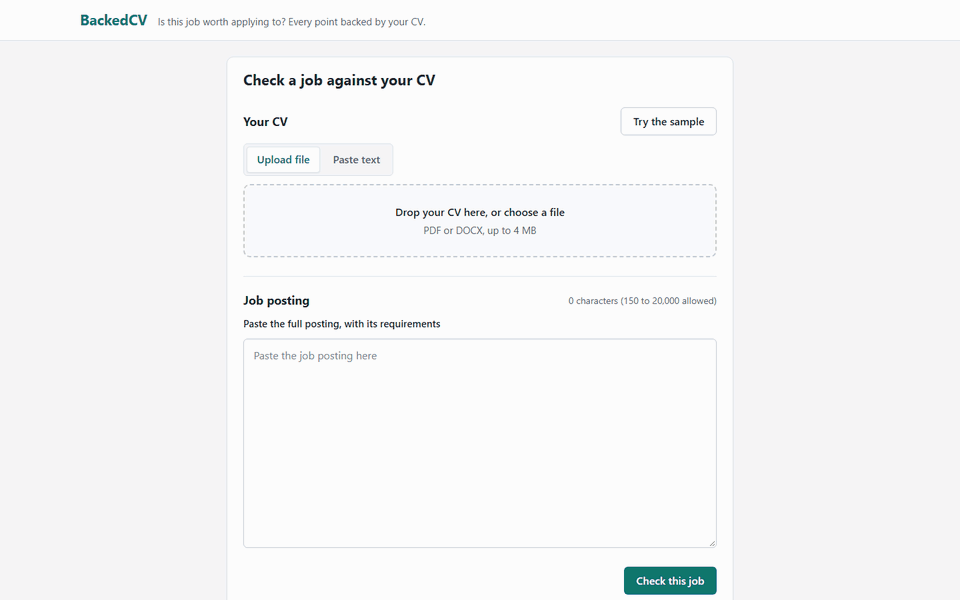

## Why

Most applicant tracking systems (ATS) do not auto-reject on keywords. Knockout questions usually do: work authorization, licenses, minimum years, location. Volume is the bigger problem: an entry-level role can draw hundreds of applications. Popular tools mostly give one opaque keyword score, which does not show what would screen you out. Some AI CV writers add experience you do not have.

## What it does

1. **Reads your CV.** It extracts the text from a PDF or DOCX and shows what a parser reads, line by line. It flags parse warnings, such as a two-column PDF.
2. **Splits the posting into requirements.** Each one has a type (skill, job title, education, years, language) and is required or preferred. Knockouts are the questions an employer usually screens on, such as work authorization or location. Red flags catch absurd requirements, such as 3 or more years for an entry-level role, or years asked for a technology younger than that.
3. **Finds the evidence.** Each requirement is linked to the CV lines that prove it, by exact words or by meaning.
4. **Flags hidden screening risks.** It reads the whole posting for buried disqualifiers, such as "we are unable to sponsor work visas" in a closing note or Kubernetes "within the last 5 years", quotes them, and checks them against your CV and your answers. Each CV line inherits the dates of its job, so old evidence is marked; a requirement whose keyword is in your CV but whose evidence is too old is marked "Looks met, but...".
5. **Gives a verdict and ranks what to fix.** One headline number, the skills match (Fit: do you meet the requirements?), and in the details an exact-word match (Keyword coverage: would an exact-term search find you?). The verdict is Likely screened out, Answer questions first, Apply, Stretch or Long shot; only a legal ban (work permit, clearance, license) or a "No" to a firm rule screens you out on its own. The open yes/no questions sit right under the verdict, and answering them updates it without a new model call. Then a numbered list ranks what to fix in three tiers (could rule you out, serious gap, worth improving), each item with the posting's sentence next to your CV line and one thing to do, followed by how your CV's dates were read.
6. **Suggests CV edits and checks each one.** "Optimize my CV" suggests rewording, skills and a summary, aimed at requirements you meet in different words. Each suggestion is checked by code, then by a separate model call. Anything the CV does not back is marked unsupported and cannot be accepted. A three-pass gate then refuses edits that are backed but not viable (evidence outside the posting's window, or a hidden barrier that no rewording can fix), with the reason.
7. **You review.** Accept or reject each suggestion. You can edit one, and the edited version is checked again.
8. **Builds the new CV.** Only accepted, verified changes are applied, in code. An agent may reorder sections and items, but it cannot write text. You get a DOCX and a PDF, and the report shows keyword coverage before and after.

## Screenshots

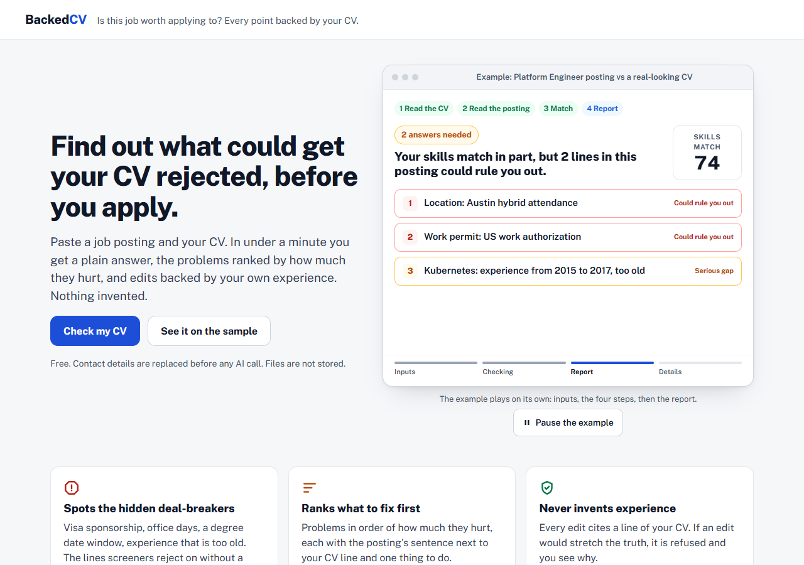

The first screen: an example report plays on its own before you upload anything. Then try the samples, or paste a posting and add your CV.

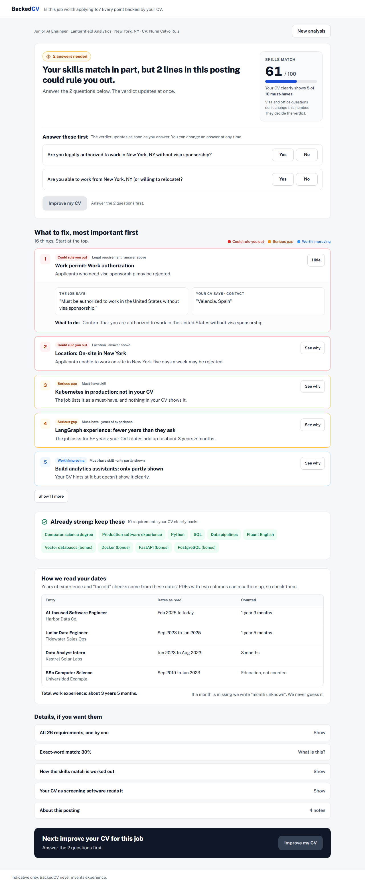

Report (the default sample): the verdict in one sentence and one number, the yes/no questions that can change it, then what to fix, most important first, in three tiers. What already works and how the CV's dates were read come next; everything else is folded into Details.

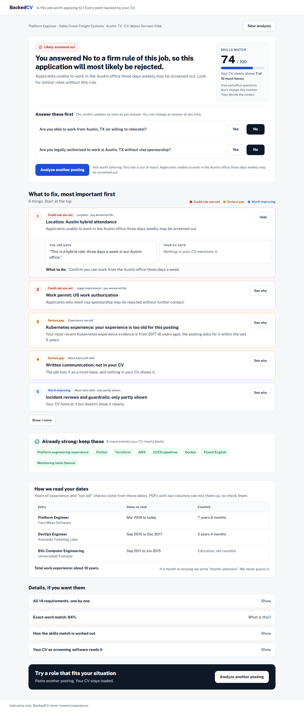

Answering No to a firm rule (here the Austin office and the work permit) gives "Likely screened out", and the page stops offering to tailor the CV.

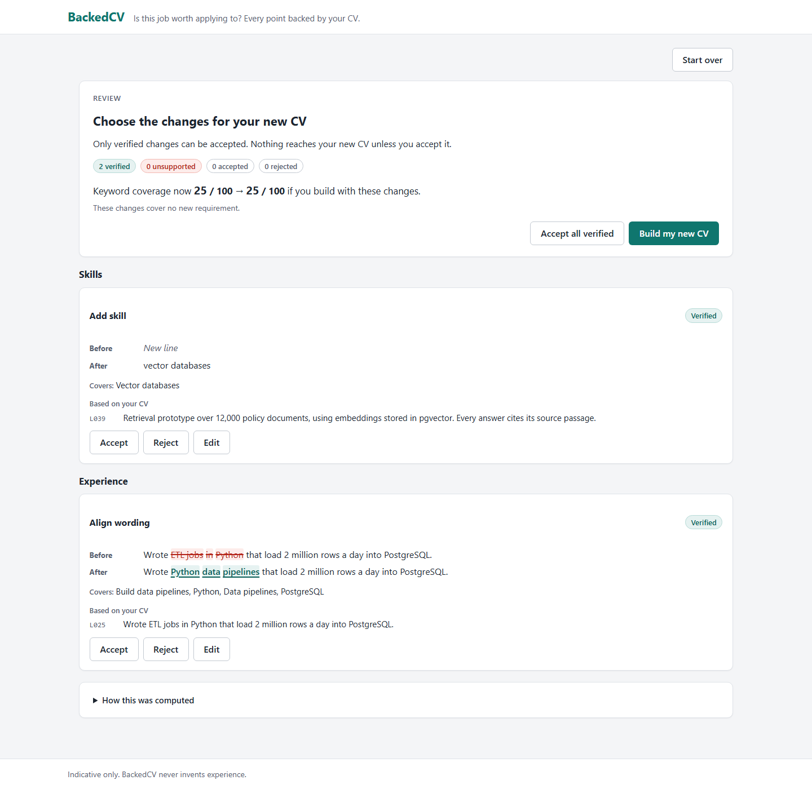

Review: each suggestion shows before and after, the CV line it rests on, and whether it is verified.

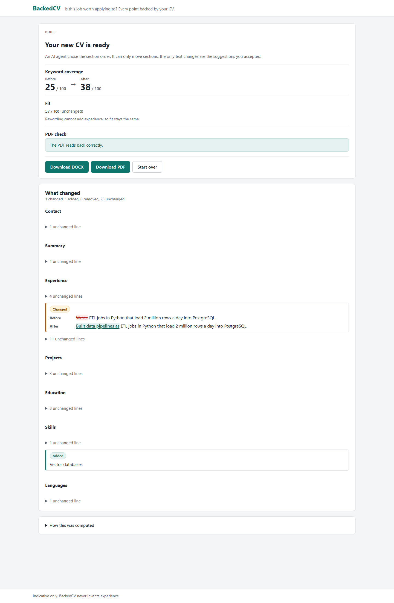

Built: keyword coverage goes up, while Fit stays the same because rewording adds no experience.

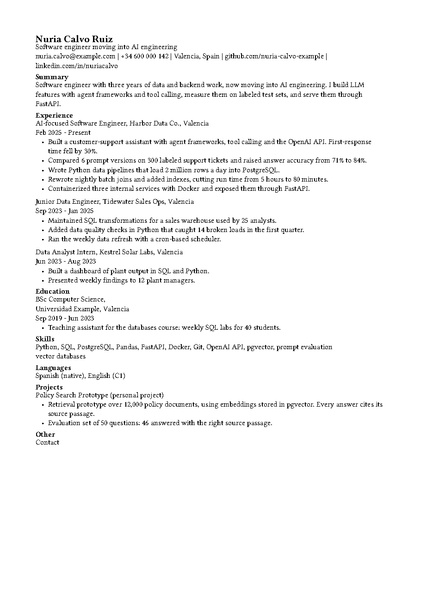

The rebuilt CV as a PDF (sample data): the accepted rewrite is in Experience, and the new skill is in Skills.

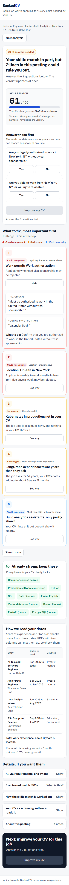

The report on a phone-sized screen.

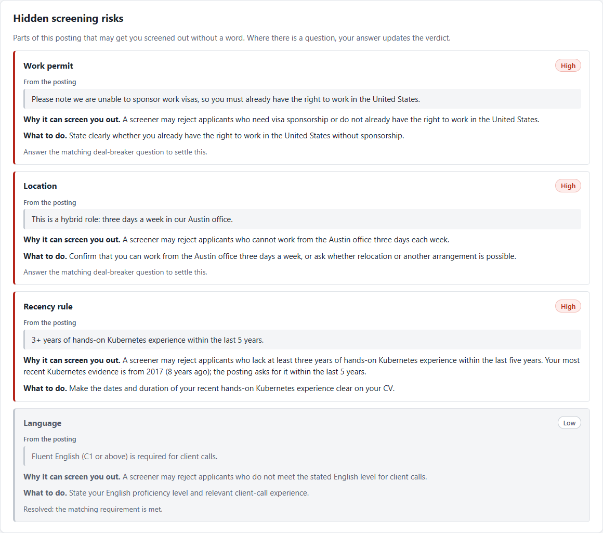

Challenge Card 1, "Try a posting with hidden barriers" (shown before the Card 2 redesign, which moved these risks into the "What to fix" list): each risk quotes the posting, says why it can screen you out and what to do. The work permit sentence was buried in the posting's closing notes; the CV is located in Spain.

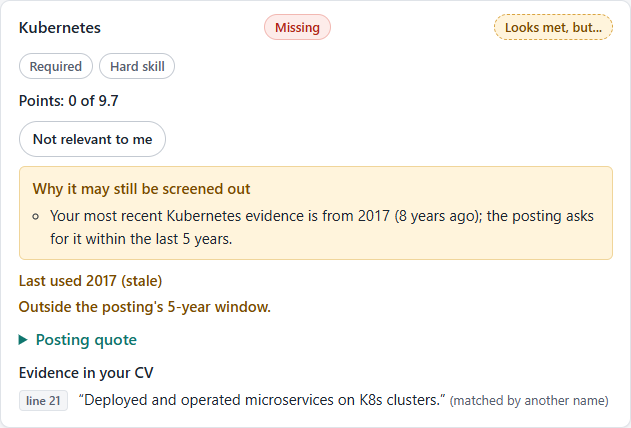

Kubernetes is in the CV, but only in a 2015-2017 job, and the posting asks for it within the last 5 years: it no longer counts as met.

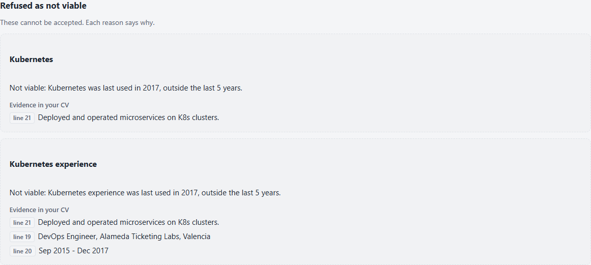

In the review, the Kubernetes edit is refused as not viable instead of rewording the old line to look current.

## What is different

- **Knockouts and absurd requirements.** Screening questions are marked as knockouts and come first in the verdict. Absurd requirements are flagged.
- **Hidden screening risks and old experience.** Buried disqualifiers are quoted from the posting and rated in code against your CV; experience outside a stated window stops counting, and an edit that would make old experience look current is refused with the reason.
- **No invented experience.** Each rewrite passes code checks, then an independent verifier that does not see the rewriter's reasoning, then your review. An unsupported rewrite cannot be accepted. The misses are reported below.
- **A published, explainable score.** The weights and rules are in [docs/scoring.md](docs/scoring.md). Every point traces back to one requirement and its status.
- **Matching by meaning.** A model matches requirements to CV lines by meaning, not only by exact words. If the model skips a requirement or fails, the code falls back to exact matches.
- **Cheap and honest.** A cheaper model handles extraction and matching; a stronger one handles only rewrites and their checks. Identical model calls reuse a stored answer, and the text is normalized first, so extra spaces or blank lines never change the result; the built-in samples replay answers pinned from a real run, so they always give the same report. In the live runs, the verifier cost under one cent per run. The score is marked indicative, and this README reports the misses.

**Not a new idea.** BackedCV is inspired by Jobscan and similar tools, such as Rezi and Teal. Match scores and CV suggestions already exist in those tools. I claim only the six points above.

## Measured, not assumed

The fabrication set tests the no-invention rule. It has 40 synthetic CV rewrites, all written by hand: 20 faithful to the CV and 20 that invent something (a tool, a title, a number, a degree, a bigger role). It has two splits of 20, `dev` and `heldout`, each with 10 of each kind. The headline number uses `heldout`.

Latest live run (2026-10-11, 02:57), `heldout`: 10 of 10 invented rewrites blocked (3 by the code checks, 7 by the verifier). 1 of 10 faithful rewrites blocked by mistake (C29, by the verifier). Across all 40 cases: 20 of 20 invented rewrites blocked, and 19 of 20 faithful rewrites passed.

Variation across the four live runs of 2026-10-11. Heldout gave the same totals in all four. Dev did not: two runs missed one invented rewrite (C09) and blocked one faithful rewrite (C13).

| Run | Heldout: invented blocked | Heldout: faithful blocked by mistake | Dev: invented missed | Dev: faithful blocked by mistake |
|---|---|---|---|---|
| 02:45 | 10 of 10 | 1 (C29) | 0 | 0 |
| 02:46 | 10 of 10 | 1 (C29) | 1 (C09) | 1 (C13) |
| 02:49 | 10 of 10 | 1 (C29) | 1 (C09) | 1 (C13) |
| 02:57 | 10 of 10 | 1 (C29) | 0 | 0 |

The verifier is a language model, so its answers can change between runs. The live runs skip the answer cache, so the verifier is asked again each time. A new code check was also added between the 02:49 and 02:56 runs: a computed years total cannot be attached to one job or skill. It now catches C09 and C36 before the verifier does. Verifier cost was $0.0047 to $0.0070 per live run (10 calls, no failures). All live runs used `gpt-6-luna`, the cheap model, for every call, to fit the event's API budget.

A missed case is an invented rewrite that passed the code checks and the verifier, so it would show as verified. Your review is the last check. A faithful rewrite that is blocked by mistake cannot be accepted as it is, but an edited version is checked again.

End-to-end smoke pairs check the analysis itself on four synthetic CV and posting pairs: the two-column demo sample, a simpler sample, a non-tech one (a registered nurse posting with a license knockout the CV answers), and the Challenge Card 1 pair (a posting with a buried no-sponsorship sentence and a 5-year Kubernetes window, and a CV in Valencia whose only Kubernetes line is from 2015-2017). Each pair has expectations (knockout questions asked or settled, R1/R2 flags, the R3 banner, the two-column warning, a verdict that is not "screened out", matching by meaning: "agent frameworks" in the CV counts as partial evidence for LangChain and LangGraph, and for Card 1 a high work permit risk, Kubernetes downgraded by recency, flagged "Looks met, but..." and its edit refused as not viable). Latest live run: 4 of 4 pairs and 20 of 20 checks passed, for $0.0119. The first run after Card 1 missed one check (the work permit risk came out medium because the posting also listed it as a knockout); I fixed the rule and kept both reports.

The offline run needs no API key and runs only the code checks. Commands and the case list are in [backend/evals/README.md](backend/evals/README.md).

## How it works

The backend is a FastAPI app. Each analysis runs as one LangGraph graph, and it pauses twice for you: after the report, and at review. FastAPI also serves the built React frontend at `/`.

- Model calls use OpenAI with strict output schemas. By default, `gpt-6-luna` handles extraction, matching and ordering, and `gpt-6.1-sol` handles rewrites and their checks.
- The score is computed in code from published weights. The model never computes it.
- Analyses are stored in SQLite and deleted after 24 hours (see [Privacy and limits](#privacy-and-limits)).

Details: [docs/architecture.md](docs/architecture.md) (graph, model calls, API, the no-invention pipeline) and [docs/scoring.md](docs/scoring.md) (weights, rules, verdicts).

## Run it

The analysis calls OpenAI, so you need an API key.

### Docker Compose

1. Copy the example settings file, then set `OPENAI_API_KEY` in `.env`:

   ```
   cp .env.example .env
   ```

2. Build and start:

   ```
   docker compose up --build
   ```

3. Open http://localhost:8000 and click **Try the sample** to load a sample CV and posting.

### Local development

You need Python 3.12 or newer, uv and Node.js (the Docker build uses Node 24). The backend reads `.env` from the repository root, so set your key there as above.

Backend, from `backend/`:

```
uv run uvicorn backedcv.main:app --reload --port 8000
```

Frontend, from `frontend/`, in a second terminal:

```
npm install
npm run dev
```

Open the address Vite prints (http://localhost:5173 by default). Vite sends `/api` requests to port 8000.

Tests, from `backend/`:

```
uv run pytest
```

## Technologies and AI tools used

- Python 3.12
- FastAPI
- LangGraph
- LangChain
- OpenAI API (default models gpt-6-luna and gpt-6.1-sol)
- LangSmith (optional tracing)
- pdfplumber
- python-docx
- lxml
- Typst
- React 19
- TypeScript
- Vite
- Docker
- uv
- ruff
- pytest
- Claude Code (AI coding assistant)

## How it evolved

BackedCV adapts to the hackathon's Challenge Cards as they arrive. Each card is summarized in [docs/challenge-cards.md](docs/challenge-cards.md) (what stayed, what changed, what is new, and the demo); the decisions and the options I rejected are in [docs/decision-log.md](docs/decision-log.md).

- **Before the cards (Ignition and the night):** the full flow from CV and posting to a verified, rebuilt CV; then reliability, privacy and matching by meaning.
- **Card 1, hidden screening barriers and recency:** a model call finds buried disqualifiers with exact quotes, code rates them against the CV and the candidate's answers (two medium risks combine into a high one), evidence outside a stated window stops counting, and a three-pass corroboration gate (backed, recent enough, not blocked) refuses edits that are backed but not viable. Everything that existed keeps working: all earlier tests and end-to-end pairs still pass.
- **Card 2, real-world feedback:** I put a temporary live demo online and shared it on LinkedIn, X, Reddit and the participants' WhatsApp group. Three participants answered: two found the report overwhelming and too long; one asked for the posting's sentence next to the CV line, deal-breakers kept apart from preferences, and a preview of how the dates were read. The report now goes from simple to complex (the verdict in one sentence, the questions under it, what to fix first in three tiers, what already works, the dates as read, the details folded away), and the first screen plays an example of the result. An AI-run test, which I don't count as feedback, also led to fixes: the same CV and posting now give the same report whatever the whitespace. The proof, with before and after: [feedback/](feedback/README.md).

## Privacy and limits

- The uploaded file is not kept. The app reads it during the request and stores only the extracted text. An analysis (its CV text, posting and results) is deleted after 24 hours. A purge runs at startup and then every hour. `DELETE /api/analyses/{analysis_id}` deletes one earlier.
- OpenAI receives the CV and posting text in each model call, with email addresses, phone numbers and links replaced by placeholders first: the model never sees them.
- Model answers, which can contain text from your CV, are cached in `data/llm_cache.sqlite` (the `backedcv-data` volume under Docker Compose) so identical calls are not paid twice. The hourly purge deletes cached answers older than 24 hours, like analyses. Set `BACKEDCV_LLM_CACHE=false` to turn the cache off.
- LangSmith tracing is optional. Without `BACKEDCV_ENV=prod`, traces include the CV and posting text. With it, inputs and outputs are hidden. The default is `dev`.
- Limits: a CV file up to 4 MB and 6 PDF pages, with up to 30,000 characters of text; a posting of 150 to 20,000 characters. Model-using requests are limited to 30 per IP address per hour and 300 per UTC day for all users (defaults, set with `BACKEDCV_RATE_LIMIT_PER_HOUR` and `BACKEDCV_DAILY_MODEL_RUNS`).
- The score is indicative. It shows how your CV lines up with a posting under these published rules. No tool can reproduce a specific company's real ATS score.

## Transparency note

At registration I submitted a different idea (website URL to promo video). I dropped it before the event started, with no code written for it, and chose this problem instead. BackedCV is being built from scratch during these 24 hours.

## License

MIT. See [LICENSE](LICENSE).
