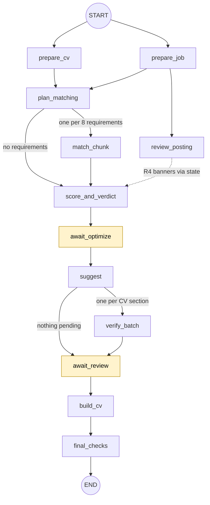

# Architecture

BackedCV checks a CV against a job posting. The backend is a FastAPI app in `backend/src/backedcv`. Each analysis is one LangGraph run with two pauses for the user. FastAPI also serves the built React frontend at `/`.

## 1. Overview and data flow

upload -> read -> analyze -> report pause -> suggest -> verify -> review pause -> build -> download

1. **Upload.** `POST /api/analyses` takes the posting text and the CV (PDF, DOCX or pasted text).
2. **Read.** The CV becomes numbered lines (`L001`, `L002`, ...). PDFs are read with pdfplumber, two-column pages column by column. DOCX is walked as XML with lxml. Limits: CV up to 4 MB, 6 PDF pages and 30,000 characters; posting 150 to 20,000 characters.
3. **Analyze.** The graph extracts requirements, matches them to CV lines, then scores and gives a verdict. It stops at pause 1 (`report_ready`). While paused, `PATCH /api/analyses/{id}/inputs` changes answers and exclusions and recomputes the score, with no model call.
4. **Suggest and verify.** `POST .../optimize` resumes the run. The graph proposes CV rewrites and verifies each one. It stops at pause 2 (`review_ready`) for accept or reject decisions.
5. **Build.** `POST .../build` sends the decisions. Accepted, verified rewrites are applied in code. An order agent may reorder sections and items. Final checks render a PDF and read it back.
6. **Download.** `GET .../cv.docx` and `GET .../cv.pdf` render the built CV on request. They return 409 until the CV is built.

## 2. Graph

Built in `graph/builder.py`. Node logic is in `graph/nodes.py`, `graph/optimize_nodes.py` and `graph/build_nodes.py`. Edge labels show fan-outs and routes.

- `prepare_cv`: `structure_cv` call (optional). Builds the parsed CV and the total-experience fact (`F01`). Runs parse checks and recruiter tips.
- `prepare_job`: `extract_job` call. Locates quotes, sets the R1 and R2 flags and the R3 banner. Retry policy: 2 attempts.
- `review_posting`: `review_posting` call (optional, never scored). Its R4 banners reach `score_and_verdict` through state, not an edge.
- `plan_matching`: waits for `prepare_cv` and `prepare_job`, then routes.
- `match_chunk`: one `match_requirements` call per chunk of 8 requirements, in parallel. A failed chunk falls back to literal matching.
- `score_and_verdict`: `recompute`. Assessments, score, verdict and badges.
- `await_optimize`: **pause 1**. `interrupt({"stage": "report_ready"})`.
- `suggest`: `suggest` call for requirements that are met but lack the posting's exact terms. Runs the deterministic guards on each rewrite.
- `verify_batch`: `verify` call for one CV section's pending rewrites. One per section, in parallel.
- `await_review`: **pause 2**. `interrupt({"stage": "review_ready"})`. The resume value is the user's accepted and rejected IDs.
- `build_cv`: applies accepted, verified rewrites in code. Then the order agent, or the original order.
- `final_checks`: renders the PDF, reads it back, validates the document, compares keyword coverage before and after the build, and records fit. Writes `build_report`.

Max concurrency is 4 (`run_config`).

## 3. Model calls

| Prompt (tier) | Node | Structured output | Model sees | Code does with the answer |
|---|---|---|---|---|
| `structure_cv` (fast) | `prepare_cv` | `CVStructureDraft`: section and entry line ranges, name and location line IDs | Numbered CV lines | Builds sections, entries and contact. Dates are parsed by code. If the call fails, matching still works on the lines. |
| `extract_job` (fast) | `prepare_job` | `JobExtractionDraft`: posting meta and requirements (quote, label, terms, category, importance, knockout type, minimum years, aliases) | The posting text | Locates each quote in the posting. Drops requirements whose quote is not found, unless they are knockouts or gates. Keeps only terms found in the quote, at most 3 terms and 3 aliases. |
| `review_posting` (fast) | `review_posting` | `PostingReviewDraft`: contradictions (quotes, explanation) and doubtful credentials (name, explanation) | Posting meta fields and `R03 \| sentence` rows | Each finding with a quote or a name becomes an R4 banner. If the call fails, there are no R4 banners. |
| `match_requirements` (fast) | `match_chunk` | `MatchChunkDraft`: per requirement, a status (met, partial, missing, unknown), cited IDs, match type, rationale | 8 requirements (label, importance, category, quote, exact hits) and the numbered CV with facts | Keeps only cited IDs that exist and fills quotes from the CV. Applies the evidence rules. |
| `suggest` (strong) | `suggest` | `SuggestionsDraft`: at most 8 rewrites (kind, target, new text, cited IDs, requirement IDs, rationale) | CV lines, facts, and the requirements that are met but lack exact terms | Maps targets to section IDs and runs the guards (section 4). If the call fails, no rewrites. |
| `verify` (strong) | `verify_batch` | `VerificationBatchDraft`: per rewrite, its claims with supporting IDs, a verdict per new term, an `uncertain` flag | The full CV with facts, and one section's pending rewrites (cited IDs, new terms, new text) | Sets verified or unsupported (section 4). If the call fails, all unsupported. |
| `build_cv` (fast, order agent) | `build_cv` | Tool calls: `move_section`, `reorder_items`, `finalize` | Outline of the built CV (section and item rows with first line and dates), posting title and requirement labels | Uses the order it sets, only if the last `finalize` returned ok (section 4). |

- Tiers map to `BACKEDCV_MODEL_FAST` (default `gpt-6-luna`) and `BACKEDCV_MODEL_STRONG` (default `gpt-6.1-sol`). The order agent uses the fast model.
- Structured calls use a strict JSON schema through the OpenAI Responses API, with `store=False`. One repair attempt follows an invalid answer.
- `prepare_job` has no fallback. If its call fails, the analysis fails with an SSE `error`.
- Reasoning effort per call comes from `config/models.toml` (default `low`).

## 4. No-invention pipeline

1. **Citations by ID.** The model cites only `L###` lines and `F##` facts. Code drops unknown IDs and fills each quote from the CV text. Met or partial without a valid citation becomes missing (unknown for gates and knockouts).
2. **Posting quotes.** A requirement's quote must match the posting: exact after folding, otherwise a fuzzy match at 0.85 or more (`locate_quote`).
3. **Deterministic guards** (`domain/guards.py`), run on every rewrite in this order. A failed hard guard makes the rewrite unsupported at once. The original text (`before`) is read from the CV, never from the model.
   - `ids_exist` (hard): target, cited IDs and requirement IDs exist.
   - `cites_evidence` (hard): at least one line or fact is cited.
   - `numbers_backed` (hard): every number in the new text appears in the cited lines or the original.
   - `no_posting_entities` (hard): the posting's job title or company does not appear outside the CV's entries (skipped for summaries).
   - `length` (hard): word limit, 2 times the original plus 30 (60 for a new summary).
   - `introduced_terms` (soft): lists new names missing from the CV. Never fails.
4. **Independent verifier.** A separate `verify` call checks each rewrite against the CV. It does not see the generator's rationale. It lists each claim with the IDs that prove it, and judges each new name as a faithful name or a claim the CV does not show.
5. **Binary status.** A rewrite ends as `verified` or `unsupported`. `pending` exists only between steps 3 and 4. It is verified only if every claim is supported, no new name adds a claim, the verifier is not uncertain, and it returned claims. Otherwise the first reason is shown.
6. **User review.** Pause 2 takes the accepted and rejected IDs. Only rewrites that are both accepted and verified are applied.
7. **Code-applied changes.** `apply_suggestions` is deterministic. `align_wording` replaces one line's text. `add_skill` appends a line to the Skills section (or to a new "added-skills" section at the end if there is none). `tailor_summary` replaces the Summary lines (or adds an "added-summary" section at the top if there is none). `validate_document` then checks that every original line is unchanged or replaced by an applied rewrite.
8. **Ordering agent** (`agents/cv_builder`). A tool-calling model (`create_agent`, recursion limit 25) with three tools: `move_section(section_id, position)`, `reorder_items(section_id, ordered_ids)` and `finalize()`. The first two only move sections and items, and return bad input as text. `finalize` runs `validate_document`. The agent's order is used only if the last `finalize` returned ok. Otherwise the original order is kept (`built_by` = `fallback`). That also happens when there is no order model (no OpenAI key, or the app was created with an injected LLM for tests) or the agent raises.
9. **Read-back check** (`final_checks`). The document is rendered to PDF with Typst, the PDF is read back with the app's own reader, and every document line's words must appear in the extracted text, in order. Failures go to `build_report.roundtrip_issues`. `validate_document` errors go to `validation_errors`. The check reports only. It does not stop the build.

## 5. API

| Method | Path | Purpose | SSE events |
|---|---|---|---|
| GET | `/api/health` | Status, version, whether an OpenAI key is set | none |
| GET | `/api/meta` | Version, model names, input limits | none |
| GET | `/api/samples` | Sample CV and posting text | none |
| POST | `/api/analyses` | Start an analysis (multipart: `job_text`, `cv_file` or `cv_text`, optional `facts` JSON). Runs up to pause 1 | `created`, `progress`, `error`, `report` |
| GET | `/api/analyses/{analysis_id}` | Current projection of an analysis | none |
| PATCH | `/api/analyses/{analysis_id}/inputs` | Set `facts` (answers), `excluded_ids`, `included_flagged_ids`; recompute score and verdict. Only at pause 1 | none |
| POST | `/api/analyses/{analysis_id}/optimize` | Resume pause 1: write the suggestions and verify each one. Pauses at review | `progress`, `suggestions`, `error` |
| POST | `/api/analyses/{analysis_id}/build` | Resume pause 2 with the user's `accepted` and `rejected` IDs: apply, order, final checks | `progress`, `built`, `error` |
| POST | `/api/analyses/{analysis_id}/suggestions/{suggestion_id}/verify` | Check an edited suggestion again: guards, then the verifier. Only while waiting at review | none (JSON projection) |
| GET | `/api/analyses/{analysis_id}/cv.docx` | Download the built CV as DOCX | none |
| GET | `/api/analyses/{analysis_id}/cv.pdf` | Download the built CV as PDF, rendered on request | none |
| DELETE | `/api/analyses/{analysis_id}` | Delete the analysis and its checkpoints (204). 409 while it is running | none |

- `created` carries the analysis ID. `progress` carries `step` and `status` per graph step. `error` carries `code` (`analysis_failed`, `optimize_failed`, `build_failed`), `title` and `detail`. `report` carries the projection at pause 1. `suggestions` and `built` carry the projection at the end of their step.
- Projection `status` is `running`, `paused`, `done` or `stalled`. `stage` is `report_ready`, `review_ready`, `built` or null.
- Errors are JSON `{code, title, detail}` with a 4xx status, for example `job_too_short`, `cv_unsupported_type`, `not_found` (404), `not_paused` and `wrong_stage` (409), `not_built` (409), `inputs_invalid` and `decisions_invalid` (422), `invalid_request` (422, malformed body).
- One run per analysis at a time (`run_in_progress`, 409). The lock lives in memory, so run one server process.
- In PATCH, a sent `facts.answers` map replaces the stored map. Other fact fields not sent keep their values.

## 6. Storage and privacy

- **Kept:** LangGraph checkpoints in SQLite, `checkpoints.sqlite` in `BACKEDCV_DATA_DIR` (default `<repo>/data`, `/app/data` in Docker). One thread per analysis ID, one checkpoint per step. Next to it, `analyses.sqlite` holds each analysis ID and creation time, which the purge reads. The state holds the file name, size and line count, the CV's text lines, the posting text, the parsed CV and job, answers and exclusions, model drafts, assessments, rewrites, decisions, the built document, the build report, token usage and errors.
- **Not kept:** file bytes. The upload is read inside the request and turned into lines before the graph starts. The state holds plain JSON-friendly values (`graph/state.py`). The PDF rendered for the read-back check is not stored.
- **Purge:** analyses older than 24 hours are deleted with their checkpoints. A pass runs at startup and then every hour (`api/retention.py`, started by `main.py`). An analysis that is running is skipped until the next pass. `DELETE /api/analyses/{id}` deletes one on request.
- **Model provider:** CV and posting text go to OpenAI in each model call, with `store=False`.
- **Tracing (LangSmith, optional):** turned on only by environment variables: `LANGSMITH_TRACING`, `LANGSMITH_API_KEY`, `LANGSMITH_PROJECT` (see `.env.example`). `settings.py` loads the repo's `.env` into the environment without overriding real variables. LangChain reads the LANGSMITH_* variables itself. The app adds run names, `analysis_id` metadata and the prompt ID and version. LangChain sends run inputs and outputs by default, and the app does not mask them.
- **Settings** (`settings.py`): `OPENAI_API_KEY`, plus `BACKEDCV_` variables for `ENV`, `MODEL_FAST`, `MODEL_STRONG`, `DATA_DIR`, `FRONTEND_DIST` and `SAMPLES_DIR`.

## 7. Tech stack

- **Backend:** Python 3.12+, FastAPI, Uvicorn, Pydantic, pydantic-settings.
- **Graph and LLM:** LangGraph, LangChain (`create_agent` for the order agent), langchain-openai (Responses API). OpenAI models: `gpt-6-luna` (fast) and `gpt-6.1-sol` (strong) by default.
- **Storage:** SQLite through `langgraph-checkpoint-sqlite`.
- **Reading CVs:** pdfplumber (PDF), python-docx and lxml (DOCX).
- **Writing CVs:** Typst through the `typst` package (PDF, also used by `final_checks`). python-docx (DOCX, `render_docx`, used by the DOCX download).
- **Tracing:** LangSmith (optional).
- **Frontend:** React 19, TypeScript, Vite, oxlint.
- **Tooling and deployment:** uv (locked dependencies), ruff and pytest (dev), Docker. `node:24-slim` builds the frontend; `python:3.12-slim` runs the app as user `app` on port 8000 with Uvicorn.
- **License:** MIT.
